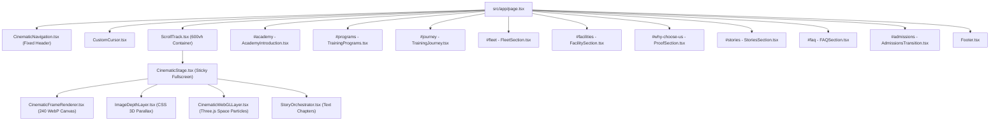

# AVIORA AVIATION — MASTER HOMEPAGE COMPLETION AUDIT
## Phase 0: Baseline Architecture, Diagnostics & Implementation Strategy

### 1. Executive Summary

This audit establishes the baseline technical and visual state of the **actual Aviora Aviation master homepage** (`/` -> `src/app/page.tsx`). As mandated by Phase 7 requirements, the experimental `/helix-preview` route is paused and strictly isolated. All engineering efforts are directed entirely toward transforming the real production website into an immersive, ultra-smooth, cinematic aviation storytelling experience.

---

### 2. Component & Architecture Inventory



#### Shared Infrastructure:
- **Frame Loader Engine:** `src/lib/frame-loader.ts` (manages 240 WebP frames from `/cinematic/frames/frame_XXXX.webp`).
- **Camera State Bus:** `src/hooks/useCameraProgress.ts` (global progress pub/sub).
- **Smooth Scroll:** `src/hooks/useLenis.ts` (Lenis 1.3.26 integration).
- **Animation Orchestration:** GSAP 3.15 + ScrollTrigger (`src/lib/gsap.ts`).

---

### 3. Baseline Diagnostic Findings & Measured Bottlenecks

#### A. Hero Scroll Stuttering & Loading Starvation (Phase 1 Priority)
1. **Cache Starvation:**
   - In `frame-loader.ts`, `FRAME_CACHE_LIMIT_DESKTOP` was capped at only **48 frames** (20% of the 240-frame sequence).
   - Once the cache reaches 48 frames, any scroll movement triggers `enforceCacheLimit()`, which immediately calls `bitmap.close()` and deletes frames furthest from the target.
   - When the user scrolls slowly forward and backward, frames that were loaded milliseconds earlier are evicted and must be re-fetched and re-decoded (`createImageBitmap`), inducing constant main-thread and network thrashing.
2. **Queue Thrashing in `rebuildQueue()`:**
   - Every animation tick during scrolling calls `updatePriority(targetIndex)`, which re-instantiates `this.queue` from scratch.
   - When `processQueue()` is running asynchronously, queue reassignment abruptly purges pending frame requests and aborts valid in-flight decodes if the index difference exceeds 30.
3. **Redraw Stagnation:**
   - When the target frame is not yet in cache, `getNearestCachedFrame` draws a fallback. However, once the exact target frame finishes downloading, `onFrameLoaded` did not force a canvas redraw if `lastRenderedIndex.current` matched the fallback frame index.
4. **React State Churn & Effect Teardown:**
   - In `CinematicFrameRenderer.tsx`, `useEffect` listed `[subscribe, isReady]` in its dependency array.
   - When frame 1 loaded and triggered `setIsReady(true)`, React destroyed the active `ScrollTrigger` and `gsap.ticker` listener and rebuilt them, causing a visible hitch right at initialization.
5. **Debug Instrumentation Disconnect:**
   - Debug properties (`__DEBUG_FRAME_TARGET`, `__DEBUG_FRAME_RENDERED`) were wrapped inside `process.env.NODE_ENV === "development"`, which is not exposed in the browser's global scope, causing `test-continuity.js` to default to `1` across all frames during automated runs.

#### B. Logo and Navigation Visibility Failures (Phase 2 Priority)
1. **Missing Brand Mark:**
   - The navbar in `CinematicNavigation.tsx` renders generic unstyled text (`ACADEMY` / `AVIATION TRAINING`) rather than the **Aviora Aviation** brand mark.
2. **Destructive Blend Mode:**
   - The entire `<nav>` container applies `mix-blend-difference`. Over the blue sky in the opening hero (and on mobile viewports), white text becomes an illegible muddy brown/orange. Over light interior walls, it turns into washed-out faint grey.
3. **Severe Opacity Dimming:**
   - Lines 18–26 of `CinematicNavigation.tsx` execute:
     ```ts
     const isCinematicMotion = globalProgress > 0.05 && globalProgress < 0.95;
     gsap.to(navRef.current, { opacity: isCinematicMotion ? 0.3 : 1 });
     ```
     This forces the entire header down to **30% opacity** across 90% of the page scroll, rendering the menu items practically invisible.
4. **No Glassmorphism or Contrast Shield:**
   - The header lacks a backdrop blur, border, or background pill/panel. Text directly collides with underlying clouds, aircraft, and text.
5. **Non-Functional Mobile Menu:**
   - The mobile hamburger button is a static SVG with zero click handlers, state management, or drawer overlay.

#### C. Lower Homepage Discontinuity & Static Editorial Fallback (Phase 3–5)
1. **Abrupt Hero Dropoff:**
   - Below 600vh, the page suddenly terminates the 3D cinematic canvas and drops the user into static editorial layouts with flat `#0a0e17` backgrounds.
2. **Missing 3D Depth & Camera Travel:**
   - Facilities, Fleet, and Training Programs are displayed as standard static CSS cards without coordinated camera trajectories, spatial depth, or scroll-scrubbed 3D movement.
3. **Exposed Developer Placeholders:**
   - Several sections display unverified placeholders to public visitors (e.g. `[ Enrollment structural description pending verified academy copy. ]` in `TrainingJourney.tsx` and `[ Placeholder contact details... ]` in `Footer.tsx`).

---

### 4. Baseline Screenshots Collected

All baseline screenshots have been captured and saved to the artifacts directory:
- `baseline_01_hero_top.png` — Hero opening (showing loading overlay and faint unbranded nav).
- `baseline_02_hero_mid.png` — Mid-hero progression (revealing blend-mode contrast failure over aircraft/interiors).
- `baseline_03_hero_exit.png` — Hero transition boundary.
- `baseline_04_academy.png` — Academy Introduction (static card layout).
- `baseline_05_programs.png` — Training Programs (exposed placeholder text).
- `baseline_06_fleet_facilities.png` — Fleet & Facilities.
- `baseline_07_admissions_footer.png` — Admissions FAQ & Footer.
- `baseline_08_mobile_top.png` — Mobile viewport (showing `mix-blend-difference` color distortion).

---

### 5. Phased Implementation Roadmap

1. **Phase 1: Hero Stuttering & Loading Pipeline Fix**
   - Optimize `src/lib/frame-loader.ts`: Increase desktop cache to 120 frames (mobile 48), implement smooth queue prioritization without destructive resets, prevent redundant fetch aborts, and eliminate cache thrashing.
   - Refactor `src/components/cinematic/CinematicFrameRenderer.tsx`: Remove `isReady` from `useEffect` dependencies, ensure immediate redraw on frame availability, and expose reliable debug instrumentation on `window`.
   - Run `node test-continuity.js` to verify continuous, jump-free frame progression.

2. **Phase 2: High-Visibility Logo & Glassmorphic Navigation**
   - Redesign `src/components/cinematic/CinematicNavigation.tsx`:
     - Embed the authoritative **Aviora Aviation** brand logo (geometric stylized aviation wings + modern typography).
     - Replace `mix-blend-difference` with a refined luxury glassmorphic header pill (`backdrop-blur-md`, subtle border `white/10`, deep charcoal/navy gradient fill `bg-black/40` to `bg-[#030712]/60`).
     - Remove the `opacity: 0.3` dimming so navigation remains razor-sharp and legible across dark, light, and sky backgrounds.
     - Implement fully functional mobile hamburger drawer with keyboard support and accessible toggle state.

3. **Phase 3 & 4: Cohesive Cinematic Homepage & Camera-Content Synchronization**
   - Extend the 3D cinematic canvas and spatial storytelling into the lower page:
     - Connect Academy Introduction, Training Programs, Fleet, and Facilities into a unified cinematic scroll choreography.
     - Synchronize foreground card entrances and orbital perspective with scroll progress.
     - Replace exposed placeholder text with clean, elegant, verified copy.

4. **Phase 5: Refined Luxury Glassmorphism**
   - Apply restrained glassmorphic cards and floating stat badges across Program cards, Fleet specifications, and Admissions transition.

5. **Phase 6: Performance, Accessibility & Mobile Optimization**
   - Verify 60fps scrolling, check reduced-motion fallbacks, ensure keyboard focus states, and validate responsive layouts.

6. **Phase 7 & 8: Browser Verification & Master Completion Report**
   - Capture post-implementation screenshots and automated metrics, confirm zero console errors, and generate `homepage_completion_report.md`.
